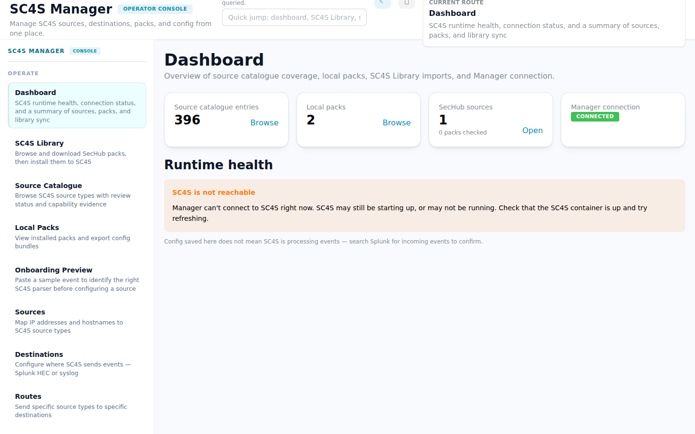
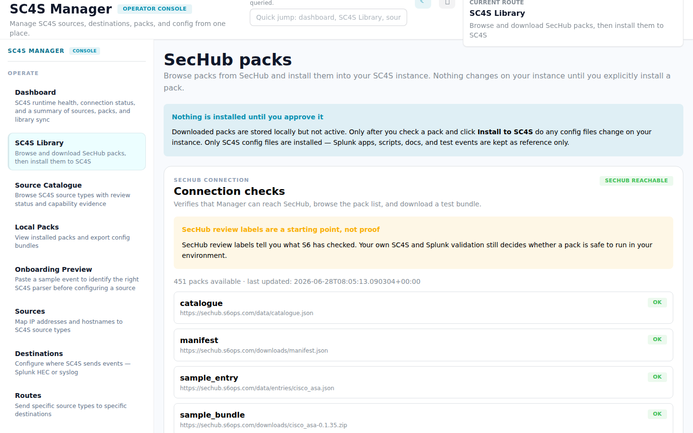
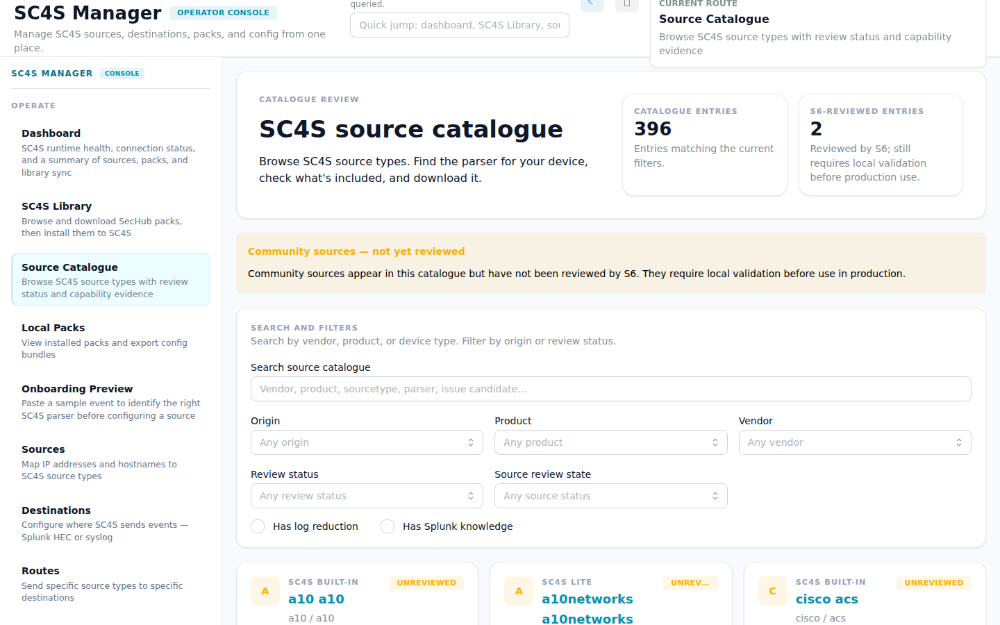
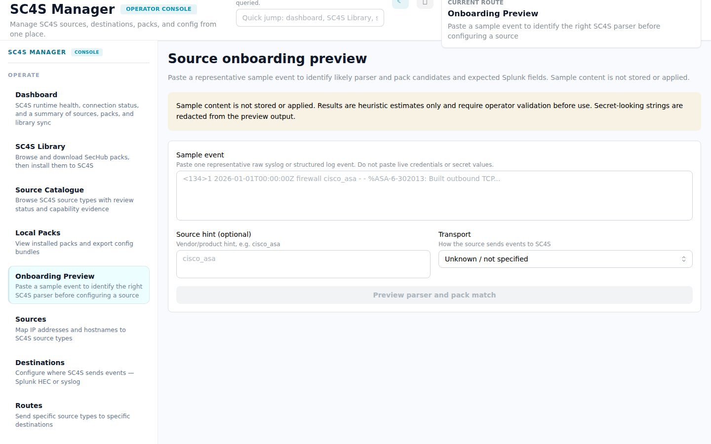
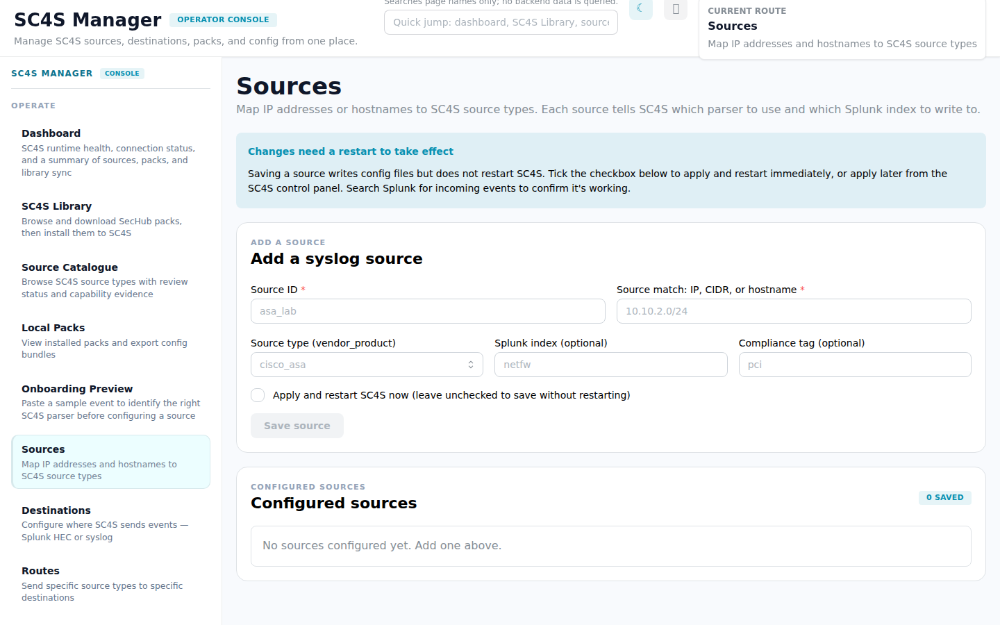
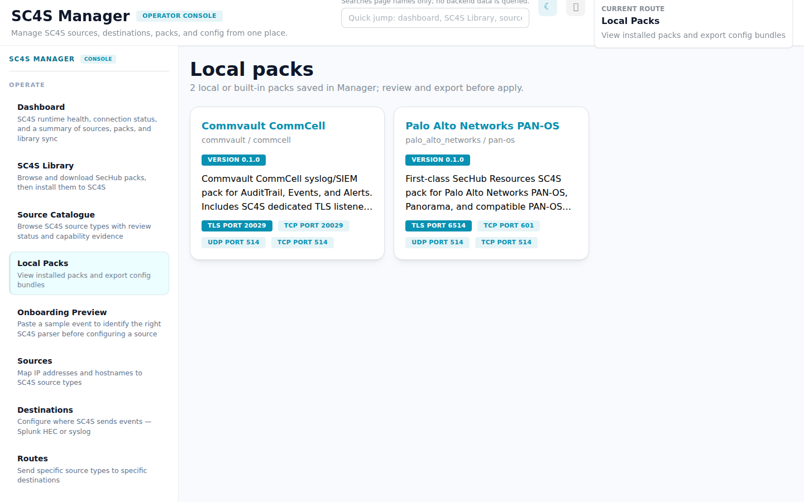
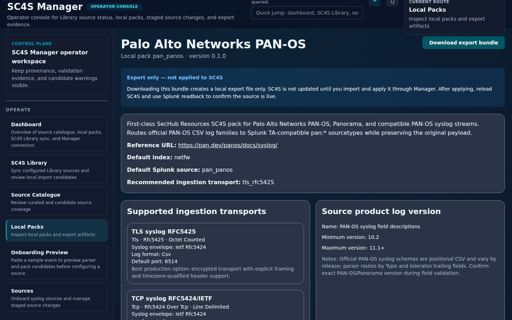
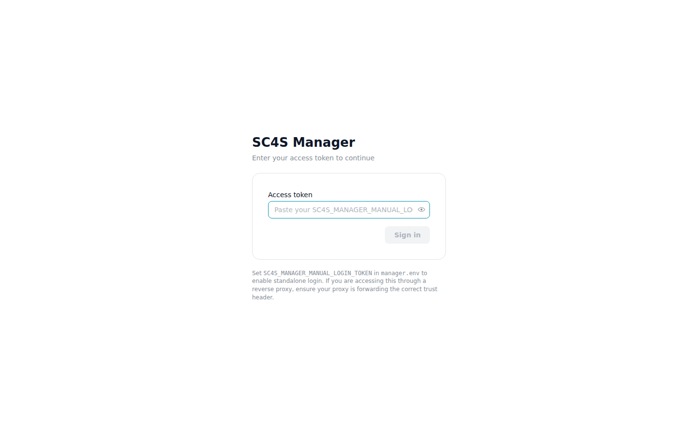

# SC4S Manager

> ## Project status: Complete
>
> SC4S Manager is finished. It was built for one specific purpose and that purpose is met: giving **junior IT staff who understand Windows but not Linux** a safe, guided way to run SC4S — browse reviewed source packs, configure sources and destinations through a UI, validate configuration before applying it, and keep an audit trail — without first having to learn syslog-ng, Linux file layouts, or SC4S internals.
>
> Our research and development focus has moved on: we are now working internally on development testing of a **complete, open-source replacement for both the SC4S pipeline and Splunk** — an enterprise-grade, end-to-end observability and logging solution that completely removes the need for ingest-licence billing. When that work is ready, it will be published as its own project.
>
> This repository remains available as-is. The code, documentation, runbooks, and release artifacts stay up for anyone who wants to use or fork SC4S Manager. It is maintained for critical fixes only.

**An operator control plane for [Splunk Connect for Syslog (SC4S)](https://splunk.github.io/splunk-connect-for-syslog/).**

SC4S is a powerful, Splunk-backed syslog collector — but configuring and operating it at scale means editing raw files, manually validating parser config, and hoping your changes don't break production. SC4S Manager gives your team a proper operator interface: browse and install reviewed source packs, manage sources and destinations through a UI, validate config before applying it, and keep a full audit trail of every change.



---

## Quick start

SC4S Manager deploys alongside SC4S using Docker Compose.

**Prerequisites:** Docker Engine, `/opt/sc4s` directory, Splunk HEC URL and token.

```bash
# 1. Create the SC4S directory layout
sudo mkdir -p /opt/sc4s/{local,archive,tls,env,manager/{state,backups,templates}}
sudo chown -R 10001:10001 /opt/sc4s/local /opt/sc4s/tls /opt/sc4s/env /opt/sc4s/manager

# 2. Copy the Compose bundle
sudo cp deploy/compose/compose.yaml /opt/sc4s/compose.yaml
sudo cp deploy/compose/.env.example /opt/sc4s/.env
sudo cp deploy/compose/env_file.example /opt/sc4s/env/env_file
sudo ln -sfn env/env_file /opt/sc4s/env_file
sudo cp deploy/compose/manager.env.example /opt/sc4s/manager.env


# 3. Configure HEC, keep the released version pin, and choose exactly one auth
#    mode (standalone or proxy). Generate the selected secret with:
#    openssl rand -hex 32
sudo editor /opt/sc4s/env/env_file /opt/sc4s/manager.env

# 4. Validate the staged deployment, then start the stack
sudo python3 scripts/preflight.py --root /opt/sc4s
cd /opt/sc4s && sudo docker compose up -d
```

Manager is loopback-only by default at `http://127.0.0.1:8090`. Access it with
the configured standalone token, or explicitly change the bind address only
after configuring the trusted proxy mode. The default deployment is
`observe_only` unless the separately installed narrow control socket is supplied;
it never mounts the Docker socket. See [docs/runbooks/install.md](docs/runbooks/install.md).

---

## What it does

### Browse and install SC4S Library packs

Browse the embedded offline SC4S Library snapshot, stage a pack locally, validate it, then install its SC4S configuration with one click. Nothing is applied until you explicitly approve it. Splunk knowledge is available for reference; Manager does not import or install product TA TGZs.



### Review the source catalogue

See every SC4S source type in one place: built-in SC4S parsers, SecHub-reviewed entries, and community candidates. Filter by vendor, review status, transport type, and evidence score.



### Paste a sample event to identify the right parser

Not sure which SC4S parser handles your log source? Paste a raw syslog event into the Onboarding Preview. Manager matches it against the catalogue and shows the likely vendor_product, Splunk sourcetype, and expected CIM fields — before you configure anything.



### Manage sources, destinations, and routes

Onboard syslog sources by IP/CIDR, map them to SC4S vendor_product and Splunk index, and preview generated config before any change is applied. Mutations create backups and validation evidence. A backup is rollback-ready, but failed control/post-check operations are not yet automatically restored on every path.



### Inspect local packs

Browse your installed packs, review their parser configs, test events, and Splunk field mappings. Export a bundle of applied config and validation evidence for handoff or change management review.





### Standalone or proxy auth

No reverse proxy? Set `SC4S_MANAGER_MANUAL_LOGIN_TOKEN` in `manager.env` and log in directly with a token. Behind Authentik, APISIX, or nginx? Use the proxy shared-secret mode — no UI login needed.



---

## Why this matters for Splunk teams

SC4S handles billions of syslog events a day in production Splunk environments. The gap has always been the operational layer: adding a new source, validating parser config, proving to change management that what you applied is what was tested. SC4S Manager closes that gap without requiring direct file system access or Docker socket exposure:

- **Preview before apply** — diff exactly which SC4S config files change before touching anything
- **Validate on the way in** — schema checks, parser syntax, fixture semantics, and a post-apply readback gate
- **Audit trail** — every mutation is logged with actor, timestamp, before/after diff, and validation outcome
- **Rollback-ready backups** — capture pre-change state and inspect rollback evidence; do not assume every failed post-check automatically restores state
- **Export evidence** — download a bundle of applied config and test fixtures for Splunk app deployment or audit

---

## Packs

Packs are self-contained configuration bundles for a specific log source. Each pack includes:

- SC4S parser config (`local/config/`, `local/context/`)
- Splunk props/transforms
- Test event fixtures with expected field output
- CIM/OCSF field mappings
- Transport and port recommendations

The `packs/` directory contains pinned built-in compatibility fixtures for Manager development. `embedded_library/` is the immutable Manager-owned offline snapshot used at runtime, with source revision provenance in `embedded_library/SNAPSHOT.json`.

---

## Contributing

SC4S Manager is community-driven. We want to make it the standard operator interface for SC4S — and that means we need packs, bug reports, and ideas from the people actually running SC4S in production.

### Submit a Library pack or product change

Canonical submissions belong in Forgejo `s6-infra/sechub-resources`, not in Manager's pinned fixture directory:

1. Open or clone canonical Forgejo `s6-infra/sechub-resources`
2. Update `products/<product-id>/` for product deployment identity, release, dependencies, or runbook work; update `packs/<source-component-id>/` only for the SC4S compatibility/evidence contract
3. Include at least one test event fixture with expected Splunk field output
4. Open a Forgejo pull request for review against the product/source-component boundary

See [docs/contributing/pack-submission-guide.md](docs/contributing/pack-submission-guide.md) for the full guide.

### Report issues and request sources

Open an issue if you find a bug, hit a parser gap, or want to request support for a new vendor/product. Snapshot refresh and coverage expansion are reviewed repository changes.

### Improve the operator experience

The UI is React + Mantine. The backend is pure Python stdlib — no framework dependencies. If you work with SC4S and have opinions about the operator workflow, pull requests are welcome.

---

## Documentation

| Doc | What it covers |
|-----|----------------|
| [docs/runbooks/install.md](docs/runbooks/install.md) | Full install guide, secret handling, proxy setup, standalone token |
| [docs/runbooks/upgrade.md](docs/runbooks/upgrade.md) | Upgrading SC4S Manager |
| [docs/runbooks/rollback.md](docs/runbooks/rollback.md) | Rolling back a failed change |
| [docs/contributing/pack-submission-guide.md](docs/contributing/pack-submission-guide.md) | How to submit a pack |
| [docs/contracts/packs-api.md](docs/contracts/packs-api.md) | Pack schema and API contract |
| [docs/architecture.md](docs/architecture.md) | Security model, auth modes, apply workflow, design principles |

---

## Repository layout

```
src/sc4s_manager/   Python backend — API, control logic, pack and library code
frontend/           React operator UI (Mantine)
packs/              Built-in packs (PAN-OS, Commvault, ...)
deploy/             Docker Compose bundle, systemd unit, env examples
docs/               Runbooks, API contracts, contributing guides, architecture
scripts/            Validation and test tooling
tests/              Backend test suite (355 tests, 81% coverage)
```

## Development

```bash
git clone https://github.com/s6securitylabs/sc4s-manager-community.git
cd sc4s-manager-community
./scripts/test.sh
```

The test script creates a virtualenv and runs the backend/package regression suite. Run `cd frontend && npm test` for the frontend suite; CI gates both.

---

## Licence

SC4S Manager is proprietary S6 Security Labs software. Use, copying, redistribution, hosted service operation, marketplace bundling, OEM use, or commercial deployment requires a separate written agreement with S6 Security Labs. See [LICENSE](LICENSE).
